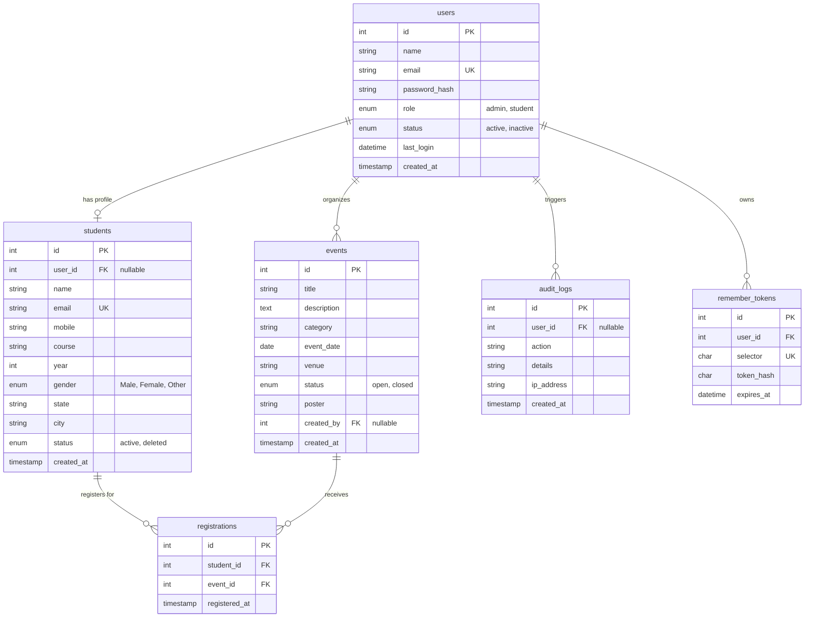

# Practical 1 & 8: Entity-Relationship (ER) Model & Database Schema

## 1. Mermaid Entity-Relationship Diagram

---

## 2. Table Specifications & Cardinalities

### 1. `users` Table
- **Primary Key:** `id` (`INT UNSIGNED AUTO_INCREMENT`)
- **Unique Constraint:** `email` (`VARCHAR(120)`)
- **Role-Based Access Control:** `role ENUM('admin','student')`
- **Security:** `password_hash VARCHAR(255)` generated via PHP `password_hash(..., PASSWORD_DEFAULT)`
- **Soft State:** `status ENUM('active','inactive')` with toggle in admin dashboard.

### 2. `students` Table
- **Primary Key:** `id` (`INT UNSIGNED AUTO_INCREMENT`)
- **Foreign Key:** `user_id` references `users(id)` with `ON DELETE SET NULL`.
- **Soft Delete:** `status ENUM('active','deleted')` enabling record retention and recovery.
- **Attributes:** `name`, `email` (unique), `mobile` (10 digits), `course`, `year` (1–4), `gender`, `state`, `city`.

### 3. `events` Table
- **Primary Key:** `id` (`INT UNSIGNED AUTO_INCREMENT`)
- **Foreign Key:** `created_by` references `users(id)` with `ON DELETE SET NULL`.
- **File Upload:** `poster VARCHAR(255)` stores sanitized unique image filename.
- **Attributes:** `title`, `description`, `category`, `event_date`, `venue`, `status` (`open`/`closed`).

### 4. `registrations` Junction Table (Many-to-Many Relationship)
- **Primary Key:** `id` (`INT UNSIGNED AUTO_INCREMENT`)
- **Foreign Key 1:** `student_id` references `students(id)` `ON DELETE CASCADE`.
- **Foreign Key 2:** `event_id` references `events(id)` `ON DELETE CASCADE`.
- **Unique Compound Key:** `UNIQUE KEY uq_reg (student_id, event_id)` prevents accidental double registrations.

### 5. `remember_tokens` Table (Persistent Authentication)
- **Primary Key:** `id` (`INT UNSIGNED AUTO_INCREMENT`)
- **Foreign Key:** `user_id` references `users(id)` `ON DELETE CASCADE`.
- **Selector/Validator Architecture:** 
  - `selector` (`CHAR(24) UNIQUE`): Public lookup identifier sent in cookie.
  - `token_hash` (`CHAR(64)`): SHA-256 hash of random 32-byte secret validator.
  - Mitigates timing attacks and prevents token exposure upon DB leaks.

### 6. `audit_logs` Table (Security & Traceability)
- **Primary Key:** `id` (`INT UNSIGNED AUTO_INCREMENT`)
- **Foreign Key:** `user_id` references `users(id)` `ON DELETE SET NULL`.
- **Attributes:** `action`, `details`, `ip_address`, `created_at`.

---

## 3. Database Normalization Justification

### First Normal Form (1NF)
- Every table has a primary key (`id`).
- All attributes are atomic (no repeating groups, comma-separated lists, or arrays stored in single fields).
- Each column contains values of a single consistent data type.

### Second Normal Form (2NF)
- The schema satisfies 1NF.
- Every non-key attribute is fully functionally dependent on the entire primary key.
- In the `registrations` junction table, surrogate primary key `id` is used alongside unique constraint `(student_id, event_id)`. There are no partial dependencies.

### Third Normal Form (3NF)
- The schema satisfies 2NF.
- There are no transitive functional dependencies (no non-key attribute depends on another non-key attribute).
- Student demographics (`course`, `year`, `mobile`) reside in `students`, while credentials and session states reside in `users`.
- Event information is isolated in `events` rather than duplicated inside each registration row.

